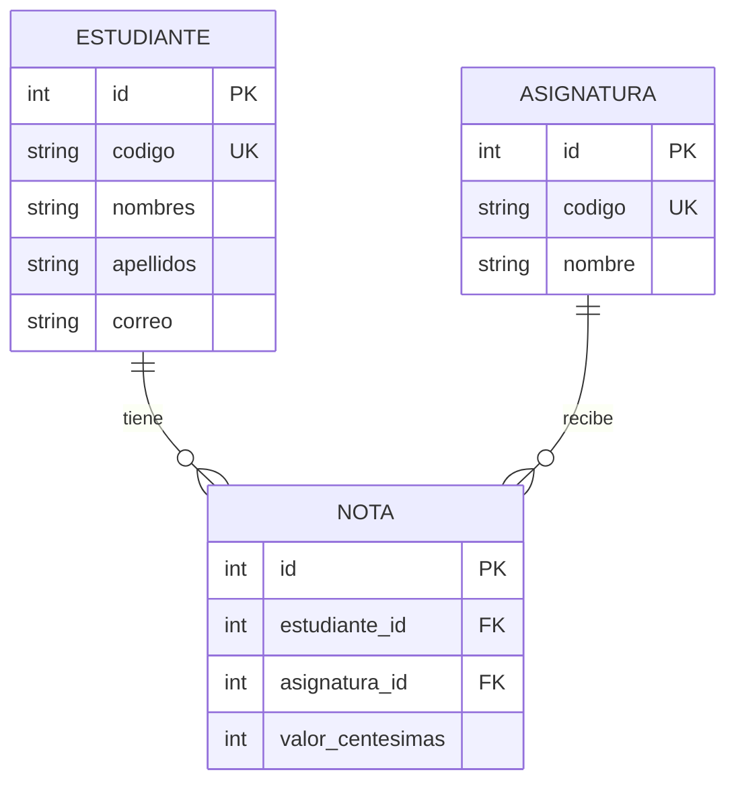

# API REST de Control académico

FastAPI publica un solo servicio con tres recursos: estudiantes, asignaturas y notas. El cliente Flutter consume JSON sobre HTTPS. Render aloja el servicio y Neon guarda los datos en PostgreSQL. Durante el desarrollo, el mismo backend puede usar SQLite.

- [Swagger UI del servicio](https://control-academico-api.onrender.com/docs) para ejecutar peticiones.
- [OpenAPI del servicio](https://control-academico-api.onrender.com/openapi.json) para consultar los esquemas y códigos HTTP.
- Base REST publicada: `https://control-academico-api.onrender.com/api/v1`.
- Base REST local: `http://127.0.0.1:8000/api/v1`.

## Arquitectura y persistencia

| Capa | Archivo | Responsabilidad |
|---|---|---|
| Aplicación | [main.py](../app/main.py) | Configura FastAPI, la conexión y el prefijo `/api/v1`. |
| Rutas | [app/rutas](../app/rutas/) | Reciben métodos y parámetros HTTP. Cada recurso tiene su router. |
| Validación | [esquemas.py](../app/esquemas.py) y [http.py](../app/http.py) | Validan entradas, definen respuestas y devuelven errores legibles. |
| Reglas de negocio | [servicios.py](../app/servicios.py) | Calcula estados y promedio, y traduce conflictos de integridad a errores de negocio. |
| Persistencia | [repositorio.py](../app/repositorio.py) y [base_datos.py](../app/base_datos.py) | Ejecuta consultas parametrizadas y gestiona las transacciones. |



La pareja `(estudiante_id, asignatura_id)` es única. Las claves foráneas impiden dejar notas sin estudiante o asignatura. La base guarda `15,50` como `1550` centésimas. La API devuelve `15.5` como número JSON y calcula el estado al consultar. Para el promedio, divide la suma de las notas por su cantidad y redondea a dos decimales. Si no hay notas, devuelve `null`.

En Render, `DATABASE_URL` se usa para atender solicitudes y `DATABASE_URL_UNPOOLED` para inicializar las tablas cuando está configurada. Las dos variables se guardan en Render y las credenciales quedan fuera del repositorio y de Flutter.

## Rutas

Todas las rutas de esta tabla se combinan con el prefijo `/api/v1`. Los valores entre llaves se sustituyen por el ID generado por la API.

| Método | Ruta | Respuesta de éxito |
|---|---|---|
| GET | `/estudiantes` | `200` · Lista paginada de estudiantes. |
| POST | `/estudiantes` | `201` · Estudiante creado. |
| GET | `/estudiantes/{id}` | `200` · Ficha del estudiante. |
| PATCH | `/estudiantes/{id}` | `200` · Estudiante actualizado. |
| DELETE | `/estudiantes/{id}` | `204` · Estudiante eliminado. |
| GET | `/estudiantes/{estudiante_id}/notas` | `200` · Notas paginadas del estudiante. |
| GET | `/estudiantes/{id}/resumen-academico` | `200` · Estudiante, notas por asignatura y promedio. |
| GET | `/estudiantes/{estudiante_id}/asignaturas/{asignatura_id}/nota` | `200` · Nota final de esa pareja. |
| GET | `/asignaturas` | `200` · Lista paginada de asignaturas. |
| POST | `/asignaturas` | `201` · Asignatura creada. |
| GET | `/asignaturas/{id}` | `200` · Datos de la asignatura. |
| PATCH | `/asignaturas/{id}` | `200` · Asignatura actualizada. |
| DELETE | `/asignaturas/{id}` | `204` · Asignatura eliminada. |
| GET | `/asignaturas/{asignatura_id}/notas` | `200` · Notas paginadas de la asignatura. |
| GET | `/notas` | `200` · Lista paginada de notas. |
| POST | `/notas` | `201` · Nota registrada con su estado. |
| GET | `/notas/{id}` | `200` · Nota encontrada. |
| PATCH | `/notas/{id}` | `200` · Nota actualizada. Solo admite `valor`. |
| DELETE | `/notas/{id}` | `204` · Nota eliminada. |

Los listados devuelven `items`, `total`, `limit` y `offset`. El valor predeterminado es `limit=20` y `offset=0`. Por ejemplo, `GET /api/v1/estudiantes/1/notas?limit=10&offset=0` usa el segmento `1` para identificar al estudiante y la consulta opcional para paginar.

## Peticiones de ejemplo en Swagger

Los datos son ficticios. Envía `Content-Type: application/json` en las peticiones que llevan cuerpo.

**`POST /api/v1/estudiantes`**

```json
{"codigo":"EST-DEMO-01","nombres":"Ana","apellidos":"Torres","correo":"ana@example.com"}
```

**`POST /api/v1/asignaturas`**

```json
{"codigo":"MAT-DEMO-01","nombre":"Matemática"}
```

**`POST /api/v1/notas`**

Usa los IDs de las respuestas anteriores. El siguiente cuerpo supone que fueron `1` y `2`.

```json
{"estudiante_id":1,"asignatura_id":2,"valor":15.5}
```

Una respuesta posible es la siguiente. El ID de la nota también lo genera el servidor.

```json
{"id":10,"estudiante_id":1,"asignatura_id":2,"valor":15.5,"estado":"APROBADO"}
```

Para cambiar esa nota, usa `PATCH /api/v1/notas/10` con `{"valor":13.99}`. La API devuelve `RECUPERACION`. Consulta después `GET /api/v1/estudiantes/1/resumen-academico` para comprobar el nuevo promedio.

## Validación y errores

| Código HTTP | Caso | Ejemplo de código de negocio |
|---|---|---|
| `404` | Recurso o referencia inexistente. | `ESTUDIANTE_NO_EXISTE`, `ASIGNATURA_NO_EXISTE`, `NOTA_NO_EXISTE` |
| `409` | Código o nota duplicados, o borrado con notas asociadas. | `NOTA_DUPLICADA`, `ESTUDIANTE_CON_NOTAS`, `ASIGNATURA_CON_NOTAS` |
| `422` | Datos fuera de rango, faltantes o con tipo inválido. | `DATOS_INVALIDOS` |

El cuerpo de error usa `detail.codigo` y `detail.mensaje`. En validaciones, `detail.errores` incluye la ubicación y el mensaje de cada campo. Las respuestas `204` no contienen cuerpo.

| Nota final | Estado JSON |
|---|---|
| De 14 a 20 | `APROBADO` |
| De 9 a 13,99 | `RECUPERACION` |
| De 0 a menos de 9 | `REPROBADO` |

La API de demostración admite consultas y escrituras sin autenticación. Usa datos ficticios y omite las cadenas de conexión de las capturas. Consulta el [README del backend](../README.md) para levantar y probar el servicio.
