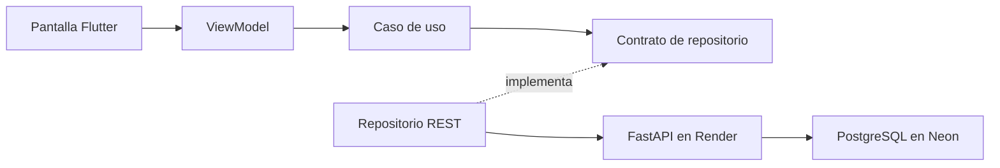

# Aplicación Flutter de Control académico

La app del caso 3 permite administrar estudiantes, asignaturas y notas finales desde Android. Usa la API de Render por HTTPS. Flutter se conecta al servidor FastAPI, que consulta PostgreSQL en Neon.

## Pantallas útiles para el informe

| Pantalla | Qué permite hacer | Qué mostrar en la captura |
|---|---|---|
| Inicio | Ver los totales y abrir los catálogos. | Estudiantes, asignaturas y notas después de registrar datos ficticios. |
| Estudiantes | Buscar por nombre o código, registrar estudiantes y abrir su ficha. | Una búsqueda que encuentre al estudiante de la demostración. |
| Ficha del estudiante | Consultar el promedio y el estado de cada nota. Registrar, editar o eliminar notas. Editar o eliminar el estudiante. | Promedio `13,75 / 20` con Matemática `15,50` y Física `12,00`. |
| Asignaturas | Crear, editar, buscar y eliminar asignaturas. | Dos asignaturas registradas. |
| Notas | Buscar por estudiante o asignatura y gestionar calificaciones. | Los estados **Aprobado** y **Recuperación** en el mismo flujo. |
| Formulario de nota | Seleccionar referencias existentes y validar una nota de 0 a 20. | Un intento con `20,01` y el mensaje de validación. |

El formulario admite coma o punto decimal. Al editar una nota solo cambia su valor. El servidor devuelve el estado y el promedio definitivo. La ficha vuelve a consultar el resumen después de registrar, editar o eliminar una calificación.

## MultiProvider, MVVM y Clean Architecture



| Parte | Dónde encontrarla | Qué explicar |
|---|---|---|
| Inyección y estado | [lib/main.dart](../control_academico/lib/main.dart) | `MultiProvider` provee el cliente HTTP, los casos de uso y los ViewModels de estudiantes, asignaturas y notas. `ChangeNotifierProvider` gestiona su ciclo de vida. |
| Modelo y casos de uso | [lib/domain](../control_academico/lib/domain/) | Entidades, contratos de repositorio y validación de calificaciones. El dominio funciona sin importar Flutter o HTTP. |
| Datos | [academico_api.dart](../control_academico/lib/data/academico_api.dart) y [repositorios_api.dart](../control_academico/lib/data/repositorios_api.dart) | Envían peticiones REST, leen JSON en UTF-8, recorren páginas y traducen errores de la API. |
| ViewModels | [view_models.dart](../control_academico/lib/presentation/view_models/view_models.dart) | Exponen listas, carga, guardado y errores. Al cambiar el estado, `notifyListeners()` actualiza las vistas que lo observan. |
| Vistas | [lib/presentation/views](../control_academico/lib/presentation/views/) | Presentan datos, validan formularios y envían acciones al ViewModel. |

La ficha crea su propio `ResumenViewModel` cuando se abre la ruta. Así el resumen pertenece al estudiante seleccionado y se libera al salir de la pantalla.

## Navegación

La ruta inicial contiene las pestañas de Inicio, Estudiantes, Asignaturas y Notas. Las rutas con nombre se resuelven en [AppRoutes](../control_academico/lib/routes/app_routes.dart).

| Ruta Flutter | Pantalla | Argumento |
|---|---|---|
| `/` | Inicio y navegación por pestañas. | Ninguno. |
| `/estudiantes/formulario` | Nuevo estudiante o edición. | Objeto estudiante cuando se edita. |
| `/estudiantes/resumen` | Ficha y notas de un estudiante. | ID del estudiante. |
| `/asignaturas/formulario` | Nueva asignatura o edición. | Objeto asignatura cuando se edita. |
| `/notas/formulario` | Registrar o editar calificación. | `ArgumentosNota` con el contexto de la ficha o nota, si aplica. |

Las rutas Flutter abren pantallas. Por ejemplo, `/estudiantes/resumen` hace que el repositorio consulte la ruta HTTP `GET /api/v1/estudiantes/{id}/resumen-academico`.

## Ejecutar y verificar en Android

Desde `2P/Tarea 2.1/control_academico` y con un dispositivo o emulador Android conectado, ejecuta:

```powershell
flutter pub get
flutter run
```

La [URL base](../control_academico/lib/data/academico_api.dart) predeterminada es `https://control-academico-api.onrender.com/api/v1`. La variable de compilación `API_BASE_URL` permite usar otra URL HTTPS mediante `--dart-define`.

Para obtener las salidas de verificación y el APK, ejecuta:

```powershell
flutter analyze
flutter test
flutter build apk --release
```

El APK queda en `build/app/outputs/flutter-apk/app-release.apk`. Las [pruebas Flutter](../control_academico/test/control_academico_test.dart) cubren límites de las notas, paginación, registro y actualización del promedio, y el mensaje al borrar un estudiante con notas. Las pruebas de interfaz usan respuestas HTTP controladas. Consulta [el guion del informe](GUIA_INFORME.md) para obtener evidencias del servicio publicado.
