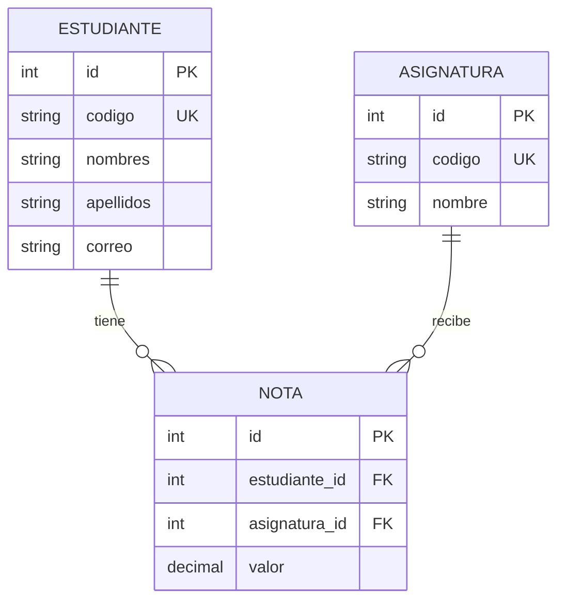

# Diseño de la API REST — Caso 3: Control académico

Fecha: 17 de noviembre de 2026.

Estado: contrato implementado. El backend de demostración está publicado en Render con PostgreSQL en Neon.

## 1. Objetivo y alcance

Crear una API REST en Python con FastAPI para que una aplicación Flutter registre estudiantes y asignaturas, gestione calificaciones y consulte el promedio por estudiante. La aplicación cliente debe utilizar Provider, MVVM, Clean Architecture y rutas, conforme al enunciado; esos patrones de presentación corresponden a Flutter.

Habrá una sola aplicación backend con tres recursos: estudiantes, asignaturas y notas. Las reglas de negocio se validarán en el servidor, aunque Flutter también valide los formularios.

El alcance comprende persistencia de datos, operaciones de registro, consulta, edición y eliminación, relaciones entre entidades y resumen académico. Las asignaturas representan un único contexto académico: no se agregan períodos, matrículas, créditos, ponderaciones ni historial de recursamientos. Tampoco se incorporan usuarios, roles, autenticación o registro de exámenes de recuperación, porque no aparecen en el caso solicitado.

## 2. Decisiones y alternativas

**Confirmado por el usuario:** una nota final por estudiante y asignatura. Un estudiante puede tener varias notas, correspondientes a asignaturas diferentes.

La alternativa de registrar varias evaluaciones por asignatura requeriría identificar las evaluaciones y acordar cómo obtener su nota final. No se adopta para esta versión.

Los campos, límites, rutas y convenciones detallados a continuación definen el contrato. SQLite sirve para el desarrollo local. El despliegue elegido usa PostgreSQL en Neon y FastAPI en Render. Ambas bases conservan las mismas rutas y el mismo JSON.

## 3. Entidades y relaciones



`NOTA` tendrá una restricción única compuesta por `(estudiante_id, asignatura_id)`. El estado académico se calcula a partir de `valor`; no se almacena ni se recibe como dato editable.

Todos los identificadores son enteros positivos generados por el servidor. La persistencia será relacional, con claves foráneas, restricciones de unicidad y eliminación restringida. Cada operación de escritura se ejecutará en una transacción. Las restricciones de la base de datos también deben proteger estas reglas ante solicitudes concurrentes.

## 4. Campos y validaciones

| Recurso | Campo de entrada | Reglas propuestas |
|---|---|---|
| Estudiante | `codigo` | Obligatorio, de 1 a 32 caracteres; letras ASCII, dígitos, punto, guion o guion bajo. Se recortan espacios exteriores y se convierte a mayúsculas antes de validar unicidad. |
| Estudiante | `nombres` | Obligatorio, de 1 a 100 caracteres después de recortar espacios exteriores. |
| Estudiante | `apellidos` | Obligatorio, de 1 a 100 caracteres después de recortar espacios exteriores. |
| Estudiante | `correo` | Obligatorio, formato de correo válido, máximo 254 caracteres después de recortar espacios exteriores. No se exige unicidad. |
| Asignatura | `codigo` | Mismas reglas del código de estudiante; único entre asignaturas. |
| Asignatura | `nombre` | Obligatorio, de 1 a 150 caracteres después de recortar espacios exteriores. |
| Nota | `estudiante_id` | Entero positivo; el estudiante debe existir. |
| Nota | `asignatura_id` | Entero positivo; la asignatura debe existir. |
| Nota | `valor` | Número JSON finito entre 0 y 20, incluidos los límites, con precisión máxima de centésimas. `13.999` se rechaza; no se redondea al guardar. |

En los cuerpos JSON no se admiten `null`, campos adicionales ni cadenas numéricas como sustituto de números. Los booleanos no se consideran identificadores ni calificaciones. Los identificadores deben representar enteros positivos, no valores fraccionarios; en las rutas se escriben como segmentos numéricos, por ejemplo `/estudiantes/1`.

El servidor genera `id`; enviarlo en una creación o actualización produce un error de validación. En `PATCH`, los campos omitidos conservan su valor, los presentes se validan igual que al crear y un objeto vacío se rechaza. Los campos de texto no pueden quedar vacíos tras recortar espacios.

La nota se guarda con precisión decimal exacta, por ejemplo en una columna equivalente a `NUMERIC(4,2)` con restricción de rango. `valor` y `promedio` se exponen como números JSON; el cliente no debe depender de ceros decimales finales. Los formatos de presentación, como mostrar `15.50`, corresponden a Flutter.

## 5. Rutas y respuestas de éxito

Prefijo de negocio: `/api/v1`. Los cuerpos y respuestas utilizan JSON. Las solicitudes con cuerpo enviarán `Content-Type: application/json`.

| Método | Ruta, relativa al prefijo | Resultado |
|---|---|---|
| GET | `/estudiantes` | `200`: listado paginado. |
| POST | `/estudiantes` | `201`: estudiante creado. |
| GET | `/estudiantes/{id}` | `200`: estudiante encontrado. |
| PATCH | `/estudiantes/{id}` | `200`: estudiante actualizado completo. |
| DELETE | `/estudiantes/{id}` | `204`: eliminado, sin cuerpo. |
| GET | `/asignaturas` | `200`: listado paginado. |
| POST | `/asignaturas` | `201`: asignatura creada. |
| GET | `/asignaturas/{id}` | `200`: asignatura encontrada. |
| PATCH | `/asignaturas/{id}` | `200`: asignatura actualizada completa. |
| DELETE | `/asignaturas/{id}` | `204`: eliminada, sin cuerpo. |
| GET | `/notas` | `200`: listado general paginado. |
| POST | `/notas` | `201`: nota creada con estado calculado. |
| GET | `/notas/{id}` | `200`: nota encontrada con estado calculado. |
| PATCH | `/notas/{id}` | `200`: nota actualizada con estado recalculado. |
| DELETE | `/notas/{id}` | `204`: eliminada, sin cuerpo. |
| GET | `/estudiantes/{estudiante_id}/notas` | `200`: notas paginadas del estudiante. |
| GET | `/asignaturas/{asignatura_id}/notas` | `200`: notas paginadas de la asignatura. |
| GET | `/estudiantes/{estudiante_id}/asignaturas/{asignatura_id}/nota` | `200`: una nota final, identificada por estudiante y asignatura. |
| GET | `/estudiantes/{id}/resumen-academico` | `200`: estudiante, notas por asignatura y promedio. |

### Formatos de recursos

- Estudiante: `id`, `codigo`, `nombres`, `apellidos`, `correo`.
- Asignatura: `id`, `codigo`, `nombre`.
- Nota: `id`, `estudiante_id`, `asignatura_id`, `valor`, `estado`.

En `POST`, se reciben los campos de entrada de la entidad, sin `id` ni campos calculados. En `PATCH`, estudiantes y asignaturas permiten modificar cualquiera de sus campos de entrada. En notas, únicamente se permite modificar `valor`: sus asociaciones permanecen fijas. Para cambiar una asociación debe eliminarse la nota y registrarse otra.

### Listados y consultas por parámetros de ruta

Los listados generales y los listados de notas por estudiante o asignatura aceptan `limit` (20 por defecto, entre 1 y 100) y `offset` (0 por defecto, entero no negativo). Estos dos parámetros de consulta se reservan para la paginación y pueden omitirse. El orden es ascendente por `id`. El cuerpo contiene `items`, `total`, `limit` y `offset`. `total` es el número de coincidencias antes de paginar.

La selección del estudiante o la asignatura utiliza parámetros de ruta (*path parameters*) en rutas anidadas, en lugar de filtros `estudiante_id` o `asignatura_id` después de `?`. `GET /estudiantes/{estudiante_id}/notas` exige que el estudiante exista; `GET /asignaturas/{asignatura_id}/notas` exige que la asignatura exista. Un recurso padre inexistente devuelve `404`. Si el padre existe pero no tiene notas, se devuelve `items: []` y `total: 0`. Una página fuera del rango devuelve `items: []` manteniendo el total real de coincidencias.

`GET /estudiantes/{estudiante_id}/asignaturas/{asignatura_id}/nota` valida que existan ambos recursos y devuelve el objeto Nota completo definido anteriormente, sin contenedor de listado ni paginación. Si ambos existen pero no tienen una nota asociada, devuelve `404` con código `NOTA_NO_EXISTE`.

Ejemplo de listado: `GET /api/v1/estudiantes/1/notas`.

```json
{
  "items": [
    {
      "id": 10,
      "estudiante_id": 1,
      "asignatura_id": 2,
      "valor": 15.5,
      "estado": "APROBADO"
    }
  ],
  "total": 1,
  "limit": 20,
  "offset": 0
}
```

## 6. Reglas académicas

| Valor de la nota | Estado devuelto |
|---|---|
| `14 <= valor <= 20` | `APROBADO` |
| `9 <= valor < 14` | `RECUPERACION` |
| `0 <= valor < 9` | `REPROBADO` |

Los estados se calculan por asignatura. `RECUPERACION` indica que puede rendir recuperación; no registra ni simula el examen. El promedio general no determina un estado global de aprobación, porque el enunciado no define esa regla.

El promedio es la suma de las notas finales registradas dividida entre su cantidad. Todas pesan lo mismo. Una nota cero cuenta como una calificación registrada. Las asignaturas sin nota no se consideran como cero ni entran en el divisor. Sin notas, `promedio` será `null` y `total_notas` será 0.

El promedio se calcula sobre valores decimales exactos y se devuelve redondeado a dos decimales con criterio `ROUND_HALF_UP`. Cada consulta lo calcula a partir de las notas actuales; crear, editar o eliminar una nota se refleja en la siguiente consulta. El resumen incluye todas las notas del estudiante, sin paginación, ordenadas por `asignatura_id`.

Ejemplo de `GET /api/v1/estudiantes/1/resumen-academico`:

```json
{
  "estudiante": {
    "id": 1,
    "codigo": "EST001",
    "nombres": "Ana",
    "apellidos": "Torres",
    "correo": "ana@example.com"
  },
  "total_notas": 2,
  "promedio": 13.75,
  "notas": [
    {
      "id": 10,
      "asignatura": {"id": 2, "codigo": "MAT001", "nombre": "Matemática"},
      "valor": 15.5,
      "estado": "APROBADO"
    },
    {
      "id": 11,
      "asignatura": {"id": 3, "codigo": "FIS001", "nombre": "Física"},
      "valor": 12,
      "estado": "RECUPERACION"
    }
  ]
}
```

## 7. Integridad y eliminación

- Registrar una nota exige que existan su estudiante y su asignatura.
- Registrar otra nota para la misma pareja produce un conflicto; no reemplaza silenciosamente la anterior.
- No se elimina un estudiante mientras tenga alguna nota. Se deben eliminar primero esas notas mediante sus rutas.
- Se propone la misma protección para asignaturas con notas, para evitar registros huérfanos.
- No se utiliza eliminación automática en cascada ni una opción para forzar el borrado.
- Eliminar una nota permite volver a registrar una nota para esa pareja y recalcula el promedio en futuras consultas.
- Los conflictos de unicidad y claves foráneas también deben traducirse a errores de negocio si se producen por concurrencia. Una operación fallida no deja cambios parciales.

## 8. Errores

Los errores de negocio tendrán el cuerpo `{"detail": {"codigo": "...", "mensaje": "..."}}`. Se propone normalizar los errores de validación al mismo contenedor e incluir `errores` para identificar los campos inválidos. Los mensajes son legibles en español y los códigos son estables para Flutter.

| HTTP | Código | Condición |
|---|---|---|
| 404 | `ESTUDIANTE_NO_EXISTE` | Estudiante objetivo inexistente, también al registrar una nota. |
| 404 | `ASIGNATURA_NO_EXISTE` | Asignatura objetivo inexistente, también al registrar una nota. |
| 404 | `NOTA_NO_EXISTE` | Nota objetivo inexistente. |
| 409 | `CODIGO_ESTUDIANTE_DUPLICADO` | Código de estudiante ya utilizado, al crear o editar. |
| 409 | `CODIGO_ASIGNATURA_DUPLICADO` | Código de asignatura ya utilizado, al crear o editar. |
| 409 | `NOTA_DUPLICADA` | Ya existe una nota para esa pareja. |
| 409 | `ESTUDIANTE_CON_NOTAS` | Se intenta eliminar un estudiante que tiene notas. |
| 409 | `ASIGNATURA_CON_NOTAS` | Se intenta eliminar una asignatura que tiene notas. |
| 422 | `DATOS_INVALIDOS` | Cuerpo JSON inválido, campos inválidos, omitidos, adicionales o nulos; parámetros de ruta o consulta inválidos; actualización vacía. |

Ejemplo de eliminación bloqueada:

```json
{
  "detail": {
    "codigo": "ESTUDIANTE_CON_NOTAS",
    "mensaje": "Elimina primero las notas del estudiante."
  }
}
```

Ejemplo de error de validación:

```json
{
  "detail": {
    "codigo": "DATOS_INVALIDOS",
    "mensaje": "Revisa los datos enviados.",
    "errores": [
      {
        "ubicacion": ["body", "valor"],
        "mensaje": "La nota debe estar entre 0 y 20 y admitir como máximo dos decimales."
      }
    ]
  }
}
```

La ubicación de los errores es una lista de cadenas o enteros, como la ruta de un campo. No se devuelve el cuerpo original de una solicitud inválida. Se valida primero la forma de la solicitud; después, la existencia de los recursos y finalmente las restricciones de negocio. Si ambos identificadores de una nota son inexistentes, se informa primero el estudiante. Los errores ajenos a estas validaciones conservan su estado HTTP correspondiente; no se convierten todos los fallos en 422.

## 9. Organización y documentación

Flujo propuesto: rutas FastAPI → servicios de negocio → repositorios → base de datos. Los modelos de entrada y salida serán independientes de los modelos de persistencia. Se separarán los routers de estudiantes, asignaturas y notas. Esta organización permite comprobar las reglas académicas sin depender de la interfaz Flutter ni del servicio de alojamiento.

FastAPI publica la documentación interactiva en `/docs` y el contrato OpenAPI en `/openapi.json`, con los modelos, parámetros y respuestas de error. La implementación usa el módulo `sqlite3` y el controlador Psycopg para PostgreSQL. Ambos motores guardan cada nota en centésimas enteras.

## 10. Criterios de aceptación para la futura implementación

1. Se pueden registrar, consultar, editar y eliminar estudiantes y asignaturas sin notas.
2. Los códigos se normalizan y no se duplican al crear ni al editar.
3. Se aceptan las notas 0, 8.99, 9, 13.99, 14 y 20, con los estados correspondientes. Se rechazan valores negativos, superiores a 20, con fracciones inferiores a centésimas, no finitos o de tipo incorrecto.
4. Un mismo estudiante puede tener notas en varias asignaturas. Se rechaza una segunda nota en la misma asignatura.
5. Una nota no puede referir a un estudiante o asignatura inexistente.
6. Editar una nota solo cambia su valor; el estado y el promedio reflejan el nuevo valor.
7. El promedio de 15.5 y 12 es 13.75; sin notas es `null`; una nota 0 sí entra en el cálculo. Se verifica también un caso de redondeo a mitad de centésima.
8. Estudiantes y asignaturas con notas no pueden eliminarse. Después de eliminar sus notas, sí pueden eliminarse.
9. Las consultas mediante parámetros de ruta y la paginación producen resultados y totales coherentes. Se distingue entre padres inexistentes (`404`), padres existentes sin notas (listado vacío) y una pareja existente sin nota (`404`).
10. Las respuestas respetan los estados HTTP, los formatos de recursos y los errores definidos en este contrato, también ante conflictos de integridad concurrentes.

## 11. Alojamiento

Para el despliegue se eligió un servicio web de Render y una base PostgreSQL de Neon. El backend selecciona PostgreSQL al recibir `DATABASE_URL` y crea sus tablas al arrancar. La configuración del servicio y las comprobaciones posteriores están en el [README de la tarea](../../../2P/Tarea%202.1/README.md).

## Referencias técnicas consultadas

- [FastAPI: aplicaciones con varios archivos y APIRouter](https://fastapi.tiangolo.com/tutorial/bigger-applications/).
- [FastAPI: modelos separados de entrada y salida](https://fastapi.tiangolo.com/tutorial/extra-models/).
- [FastAPI: actualizaciones parciales](https://fastapi.tiangolo.com/tutorial/body-updates/).
- [FastAPI: parámetros de ruta](https://fastapi.tiangolo.com/tutorial/path-params/).
- [FastAPI: manejo y personalización de errores](https://fastapi.tiangolo.com/tutorial/handling-errors/).

Las reglas académicas proceden del enunciado del caso 3 compartido en este chat. La restricción de una nota final por estudiante y asignatura fue elegida por el usuario.
